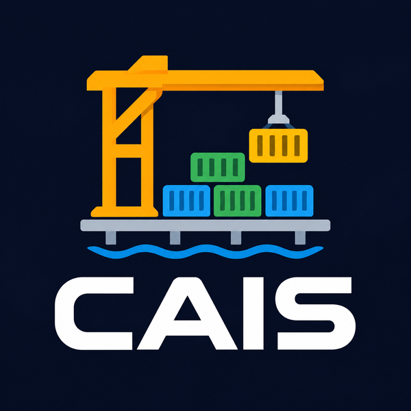

<p align="center"></p>

# cais

Painel pra preparar e operar uma VPS com Docker: proxy com HTTPS automatico,
Postgres, MySQL e S3 compartilhados, deploy de apps direto do GitHub, backup
e avisos. Voce usa por uma TUI no SSH, pelo CLI ou pela IA (MCP).

Roda na propria VPS, como servico do systemd. Nao abre porta e nao tem login
proprio: o acesso e o seu SSH.

## O que faz

- **Deploy de apps do GitHub.** Cada app e um repositorio com o compose de
  producao pronto. Deploy sem queda, volta sozinho pra versao anterior se
  falhar, historico e rollback.
- **Deploy automatico e homologacao.** A cada commit na branch, sem webhook.
  Homologacao como app separado, com promocao pra producao.
- **HTTPS automatico** com Traefik e Let's Encrypt, no dominio de cada app.
- **Bancos e S3 compartilhados.** Postgres (com PostGIS), MySQL e Garage; um
  database e um usuario por app, vazio ou importado de outro servidor.
- **Backup diario** dos bancos e do estado, criptografado, pro Google Drive ou OneDrive.
- **Avisos por e-mail** quando um deploy automatico ou um backup falha.
- **Pela IA**, com o MCP pelo mesmo SSH, sem nada que apague dados.
- **VPS segura desde o inicio.** `cais host harden` cria o admin, deixa o SSH
  so com chave e sem root e liga firewall, fail2ban e atualizacoes
  automaticas. Depois, o painel avisa se algo abrir.

## Requisitos

- Uma VPS com Linux (amd64 ou arm64) e systemd. No Ubuntu e no Debian o
  instalador poe o Docker; em outra distro, instale antes o
  [Docker](https://docs.docker.com/engine/install/) com o Compose v2.
- Sua chave SSH na VPS (o usuario que vai instalar).
- Pros apps: um GitHub App que le os repositorios e o DNS do dominio de cada
  app apontando pra VPS.

## Instalar

Na VPS, com um usuario com sudo:

```sh
curl -fsSL https://github.com/trdSystemDev/cais/releases/latest/download/install.sh |
  sudo sh -s -- --ssh
```

Instala o cais (e o Docker, se faltar), sobe o servico e cria o usuario `cais`
do SSH com as suas chaves. Opcoes e detalhes em
[docs/instalacao.md](docs/instalacao.md).

VPS nova, so com o root (Hostinger e afins)? Instale e prepare de uma vez,
como root:

```sh
curl -fsSL https://github.com/trdSystemDev/cais/releases/latest/download/install.sh |
  sh -s -- --ssh --harden deploy
```

O `--harden deploy` cria o admin `deploy` com sudo e as chaves do root. Deixa
o SSH so com chave e sem login do root, e liga o firewall (so 22, 80 e 443),
o fail2ban e as atualizacoes de seguranca. Depois entre de outro terminal com
`ssh deploy@ip-da-vps` e rode `sudo cais host confirm`. O mesmo pela TUI, em
**Setup > Seguranca > Preparar VPS**, com um **Corrigir** por item. Passo a
passo em [docs/seguranca.md](docs/seguranca.md).

## Primeiros passos

1. Do seu computador, abra o painel:

   ```sh
   ssh cais@ip-da-vps
   ```

2. Na aba **Setup**, preencha o GitHub App e clique em **Salvar**. O Setup
   so guarda a configuracao: nada sobe.
3. Na aba **Infra**, no **proxy**, ponha o e-mail do Let's Encrypt e ligue ele
   (publica os apps com HTTPS); ligue tambem o que mais for usar: Postgres,
   MySQL, Garage (S3).
4. Na aba **Apps**, **+ Novo app** com o link do repositorio. A **Ajuda** do
   app gera o trecho do compose (dominio, redes e o `cais run`, que entrega as
   variaveis ao app sem expor no `docker inspect`) pra colar no repositorio.
   Depois, **Deploy**.

O mesmo pelo CLI, na VPS (ou `ssh cais@ip-da-vps <comando>`):

```sh
cais service proxy on
cais app create loja dono/loja -compose docker-compose.producao.yml
cais app guide loja                     # o trecho do compose pra colar
cais app env loja DOMINIO=loja.exemplo.com.br
cais app deploy loja
```

`cais help` lista todos os comandos; `cais <comando> -h` explica cada um.

## Atualizar

Rode o mesmo comando da instalacao. Ele baixa o release mais novo e
reinicia so o daemon: os apps e os bancos continuam no ar. Pra uma versao
especifica (inclusive voltar), `--version v0.3.0`.

## Usar pela IA (MCP)

Do seu computador, depois de entrar uma vez com `ssh cais@ip-da-vps`:

```sh
claude mcp add -s user cais -- ssh cais@ip-da-vps cais mcp
```

O que a IA pode e nao pode fazer em [docs/mcp.md](docs/mcp.md).

## Documentacao

- [Instalacao](docs/instalacao.md): opcoes do instalador, atualizar, desinstalar
- [Setup e configuracao](docs/setup.md): proxy, servicos, `config.yaml`, avisos por e-mail
- [Apps](docs/apps.md): deploy sem queda, formato do compose, rollback, homologacao, deploy automatico
- [Bancos e storage](docs/bancos-e-storage.md): databases, importar de outro servidor, buckets S3
- [Backups e disco](docs/backups.md): backup pro Google Drive, restore, limpeza de disco
- [MCP](docs/mcp.md): deploy e status pelo Claude Code
- [Desenvolvimento](docs/desenvolvimento.md): arquitetura, testar no PC, build e releases

## Desenvolvimento

Go 1.25 e Docker.

```sh
make dev                   # daemon de teste e a TUI, no seu PC
make test                  # testes
make release V=v0.3.0      # tag; o GitHub Actions testa, compila e publica
```

Detalhes em [docs/desenvolvimento.md](docs/desenvolvimento.md).
